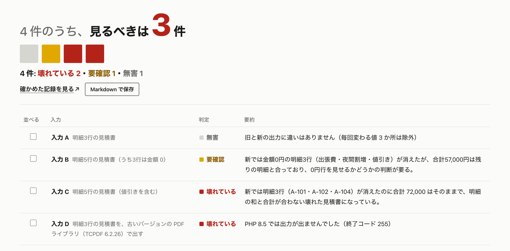
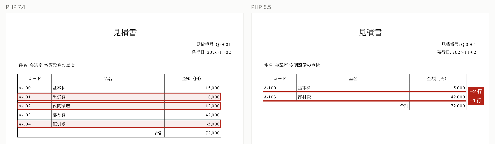

<div align="center">


# かわりめ（kawarime）

バージョンの変わり目で、見落とさない。

[デモ動画（YouTube・3分）](https://youtu.be/_5t5zFC2Emc)　｜　[審査用の公開環境](#審査用の公開環境見本)

</div>

## 概要

このプロジェクトは、言語やライブラリのバージョンを上げる開発者が、出力の壊れた箇所を見落とす問題を、Claude で違いを見分け、原因と直し方まで示すことで防ぐツールです。
直し方を示すだけでなく、ソースのコピーに当てて（適用して）もう一度動かし、出力の違いが消えたことまで確かめます。



## diff が同じでも結論が違う例

同梱した見積書の題材では4枚の見積書（入力 A〜D）を PHP 7.4 と 8.5 で出して比べます。そのうち入力 B と C は、PHP 8.5 で明細が3行消えます。diff で見ると、どちらも「同じ3行が消えた」だけで、見分けがつきません。

- **入力 B**：残った明細を足すと、合計欄と合います → **要確認**（金額0円の行を載せなくなったことで、見積の読み方が変わるかは人が決めます）
- **入力 C**：合計欄は 72,000 円のままなのに、残った明細を足すと 57,000 円です → **壊れている**

かわりめは差分だけでなく新しい出力の全文を Claude に読ませます。だから、この2枚を分けられます。



残る入力 D は、古い PDF ライブラリが PHP 8.5 で動かず、出力が出ません。最初の画像の「見るべきは3件」は、この B・C・D です。

## 主な機能

- 違いを「無害」「要確認」「壊れている」に分け、出力のどこを見れば確かめられるかを添えます
- 壊れていれば、ソースを読んで原因のファイルと行を探し、直し方を示します
- 直し方をソースのコピーに当て、全部の入力でもう一度動かして、違いが消えて直ったかを確かめます。元のソースに当てるパッチも保存できます
- どの入力で何を確かめたかを、1枚の記録に残します
- つなぎ方はコマンド・Web アプリ・出力ファイルの3つ、形式は PDF・テキスト・HTML の3つです。どれも設定ファイル1枚で切り替えます
- 同梱の題材は見積書（PHP・PDF）、架空書店の注文管理（PHP・Web アプリ）、作業日報（Python・CSV）と、本物の OSS である TCPDF の公式の例65本（PHP・PDF）です。65本のうち64本は差が無く、1本だけは PHP 8.5 で出力が出ないことを見分けました

## どんな場面で困るか

セキュリティの修正が出るたびに、言語やライブラリのバージョンを上げる必要があります。テストや仕様書があっても、帳票や画面の出力を細部まで確かめきれていない可能性があります。そこを確かめるには、新旧の出力を見比べるしかありません。

ところが diff を取ると、印刷日時や文書番号のように毎回変わる値まで「違う」と出ます。本当に困る違いはその中に埋もれてしまいます。消えた1行は目で見比べても気づきにくいものです。

私も引き継いだシステムの PHP を上げたときに、これで失敗しました。古いバージョンにはセキュリティの修正が出なくなり、上げるしかありませんでした。新旧で同じ見積書を印刷して見比べてから切り替えましたが、出力の一部が消えていたのを見落とし、使っている社員に言われて気づきました。

かわりめを使えば、テストや仕様書で確かめきれていない所があっても、新旧の出力そのものを比べて、見るべき違いを見つけられます。

## これからの使い道

- 私は、これから言語やライブラリのバージョンを上げるたびに使います。同じ入力で流し、「壊れていない」根拠を持ってから本番に出します
- 同じようにバージョンを上げる開発者なら、だれでも使えます。確かめた記録が残り、設定は Claude Code と一緒に書けるので、私以外の人でも同じ確かめ方でバージョンを上げられます

## 試す

### 審査用の公開環境（見本）

> [!IMPORTANT]
> このツールは本来、自分のシステムのソースと、旧・新の実行環境がそろったローカル環境で使います。公開環境は、同梱した架空のサンプルで画面と Claude の判定を確かめるための見本です。

https://output-parity.onrender.com を開き、提出フォームの審査員向けの欄にあるアクセスコードを入れてください。

同梱した架空のサンプルで、結果を見たり、Claude に判定し直させたり、原因を探させたりできます。旧と新の実行環境（PHP や Python）は入れていないので、「実行して判定する」と「当てて確かめる」は押せません。

- 無料の置き場なので、最初の表示に1分ほどかかることがあります
- 一度に動かせる作業は1つです
- Claude の利用には上限を付けています。上限に達すると、その回に判定できなかった入力は「要確認」と出ます

### ローカル環境

PHP と API キーが無くても動きます。Node.js 22.13 以上が要ります。

1. 取ってきて起動します
   ```sh
   git clone https://github.com/futosawaguchi/output-parity.git
   cd output-parity
   npm ci
   npm run dev
   ```
2. ブラウザで http://127.0.0.1:3000/check を開きます。同梱の結果が最初から出ます
3. Claude を呼ぶ機能（判定し直し・原因を探す）を使うときだけ、API キーを入れます。`cp .env.example .env` で写し、`.env` の `ANTHROPIC_API_KEY=` のあとにキーを書いて、`npm run dev` を起動し直します。`.env` はコミットされない設定になっています。キーはほかのファイルに書かないでください

旧と新を実際に動かす手順は [guide/setup.md](guide/setup.md) にあります。

### 自分のシステムで使う

このリポジトリを Claude Code で開き、「自分のシステムで試したい。ソースは ~/work/my-app にある」のように、ソースの場所と一緒に伝えてください。スキル（`.claude/skills/try-your-system`）が、読んでよい範囲を聞いてからソースを読み、質問しながら設定ファイルを書きます。そのあと、Claude を呼ばずに1回動かすところまで進めます。

設定ファイルの書き方は [guide/config.md](guide/config.md) にあります。

## 使った技術と動かすのに要るもの

| 項目 | 内容 |
|---|---|
| 画面とサーバ | Next.js 16・React 19・TypeScript |
| AI | Claude API（claude-opus-5-5）。判定は構造化出力、原因探しは Tool Runner |
| PDF の読み取り | pdf.js |
| 動かすのに要るもの | Node.js 22.13 以上。旧と新を実際に動かすなら、その言語の実行環境（同梱の題材では PHP 7.4・8.5、Python 3.10・3.12）と composer |
| 確かめた環境 | macOS 27.0.1（Apple シリコン）、Node.js 22.16.0、PHP 7.4.33・8.5.12、Python 3.10.20・3.12.3、composer 2.11.1 |
| 公開環境 | Linux（Docker・Node.js 22）。PHP と Python は入れていません |

## Claude の使い方

- 判定には「合計欄を確かめよ」のような帳票ごとのルールを書きません。差分だけでなく新しい出力の全文を読ませるので、入力 B と C を分けられます
- Claude の答えはプログラムが確かめます。Claude が書いた計算と引用を検算し、合わなければ「無害」を「要確認」に上げます
- 直ったかどうかは Claude に決めさせず、直し方を当てて動かし直した出力で決めます
- 原因探しで Claude に渡すのは、ファイルの一覧・読む・探すの3つだけです。読むことだけを任せ、書き込みはさせません
- 開発の中心は Claude Code です。目的ごとに次の機能を使い分けました
  - スキル：大きく変えるたびに、既存の機能が壊れていないかを同じ手順で確かめます。手で30分かかっていた確認が約5分になりました。設定を一緒に書くスキル（try-your-system）は、使う人のために用意しました
  - サブエージェント：経緯を知らない別の Claude にコードを審査させ、判定が黙って間違う不具合を4つ、壊れているのに「無害」と言う抜け道を4つ見つけて、すべて直しました
  - フック：コミットの前に鍵の文字列を探し、見つかれば止めます
  - MCP（Claude in Chrome）：画面の不具合を、直す前に実際のブラウザで再現しました

詳しくは [notes/claude.md](notes/claude.md) にあります。

## 安全とできないこと

- 本番には接続しません。書き換えるのは、ソースのコピー（`work/`）だけです
- Claude に何を送るかは、設定で選びます（何も送らない／出力だけ／出力とソース）。送る前に鍵らしい値を伏せ、送った全文を残します
- 言えるのは、試した入力の出力についてだけです。罫線や色のように、文字にならない見た目は比べません

詳しくは [guide/safety.md](guide/safety.md) にあります。

## 資料

使う人向け（guide/）

- [全部動かす](guide/setup.md)：旧と新を実際に動かす手順と、確かめ方
- [設定ファイル](guide/config.md)：自分のシステムを試すときの書き方
- [安全と Claude に送るもの](guide/safety.md)：送る範囲、伏せ字、このツールが言えること・言えないこと、確かめた入力の記録
- [仕組み](guide/how-it-works.md)：処理の流れ、Claude を使っていない所、直したあと元のソースへ入れる手順
- [同梱の題材](guide/samples.md)：4つの題材と、それぞれの壊れ方

作った経緯（notes/）

- [notes/](notes/)：設計・試行錯誤・Claude の使い方

## ライセンスとデモ動画の素材

MIT（[LICENSE](LICENSE)）。TCPDF（LGPL-3.0）と FPDI（MIT）は同梱せず、composer で取得します。同梱の見積書・書店・作業日報は、この作品のために作った架空のサンプルです。

デモ動画のナレーションは本人の原稿を Azure OpenAI の gpt-4o-mini-tts で読み上げたものです。BGM はコードで作った音で、ほかの曲や音源は使っていません。
